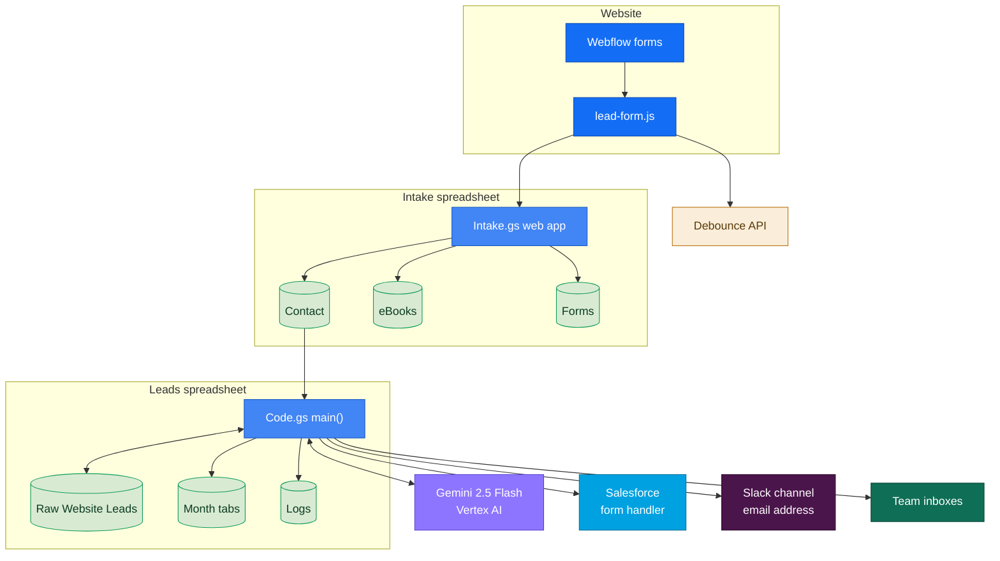
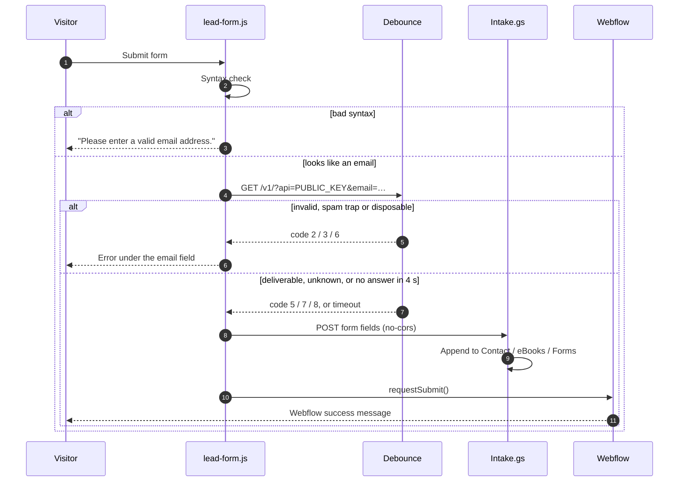
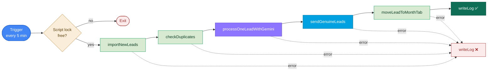
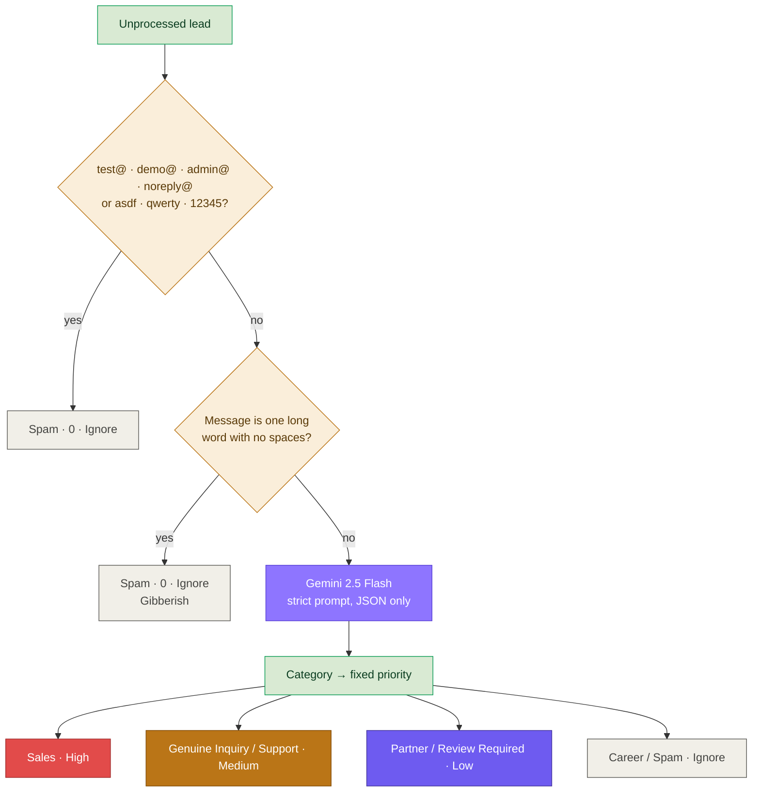
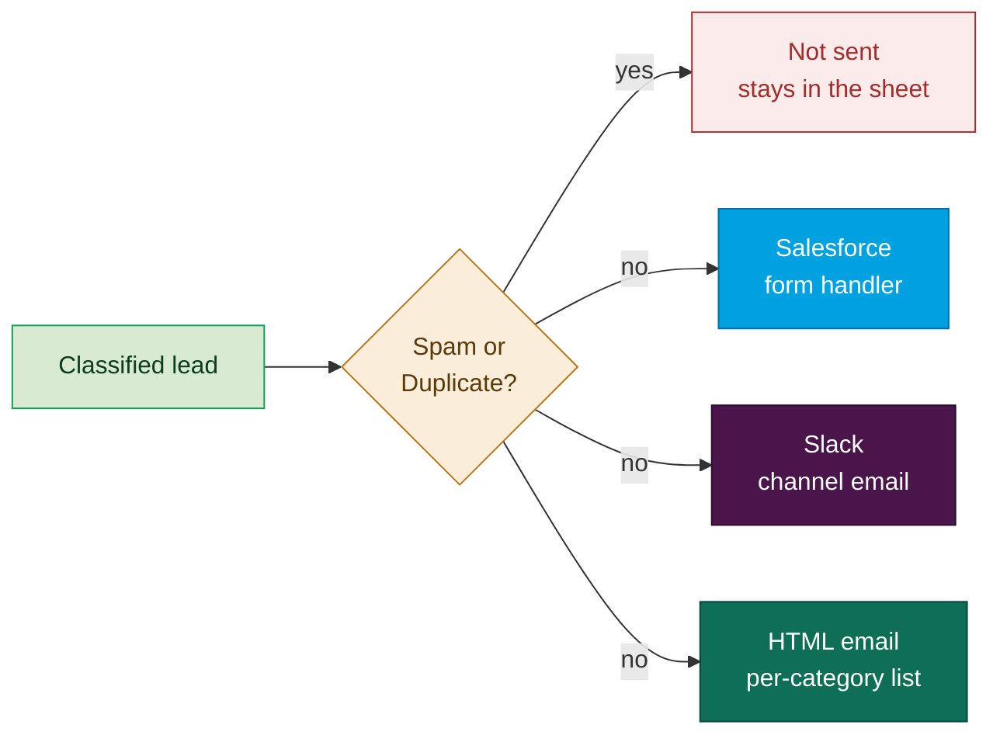
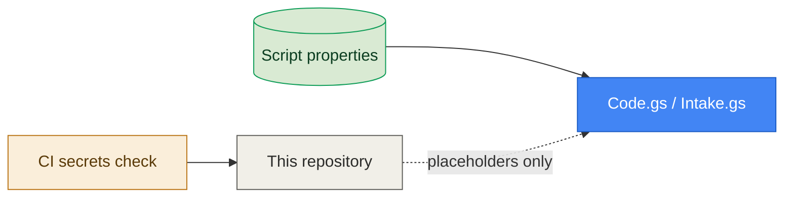

# Architecture

How a website form submission becomes a scored, routed lead. All names and addresses here are made up.

## Contents

- [System overview](#system-overview)
- [Form submission](#form-submission)
- [Pipeline run](#pipeline-run)
- [Classification](#classification)
- [Routing](#routing)
- [Sheet columns](#sheet-columns)
- [Configuration and secrets](#configuration-and-secrets)
- [Reliability](#reliability)
- [Design decisions](#design-decisions)

## System overview

| Part | Runs where | Triggered by |
|---|---|---|
| `webflow/lead-form.js` | Visitor's browser | Page load and form submit |
| `apps-script/intake/Intake.gs` | Apps Script web app | HTTP POST from the form |
| `apps-script/pipeline/Code.gs` | Apps Script bound to the leads spreadsheet | Time-driven trigger on `main()` |
| `apps-script/pipeline/Setup.gs` | Same project | Run by hand once |

## Form submission

Hidden fields are filled when the page loads:

| Field | Value |
|---|---|
| `event_page` | `document.title` |
| `formName` | The form's `data-name` in Webflow |
| `utmCampaignName` · `utmCampaignSource` · `utmCampaignMedium` | `utm_campaign` · `utm_source` · `utm_medium` from the first page of the visit (kept in `sessionStorage`) |

The intake app chooses the tab:

| Condition | Tab | Columns |
|---|---|---|
| `formName` contains `ebook` | **eBooks** | timestamp, email, form, page, 3 × UTM |
| `formName` contains `contact`, or there is a message or a reason | **Contact** | the 14 lead columns read by the pipeline |
| anything else (events, webinars) | **Forms** | timestamp, name, email, company, page, form, 3 × UTM, blank, dietary restrictions |

## Pipeline run

- **Import** reads only rows after `LAST_IMPORTED_ROW`, skips any `email|message` pair already in Raw Website Leads, then stores the new last row.
- **Duplicates** is a second safety net inside Raw Website Leads: the first `email|message` wins, later copies become `Duplicate`.
- **Classification** only touches rows whose *AI Processed* cell is empty, so each lead goes to Gemini once.
- **Routing** checks the three *Sent* columns before sending, so a lead is never sent twice, even after an error part-way through.
- **Month tabs** compare timestamp, email and message before appending, so re-runs don't copy a lead twice.

## Classification

The prompt sends first name, last name, email, company, job title, reason for contact and message, lists the seven categories with examples, and asks for `{"category","score","priority","reason"}`. Code fences are stripped before parsing. Gemini's own priority is ignored; the script sets it from the category so the sheet stays consistent.

The call uses the script owner's OAuth token (`ScriptApp.getOAuthToken()` with the `cloud-platform` scope), so there is no API key to store.

## Routing

| Category | Salesforce | Slack | Email to |
|---|:---:|:---:|---|
| Sales | ✅ | ✅ | `SALES_EMAIL_RECIPIENTS` |
| Partner | ✅ | ✅ | `PARTNER_EMAIL_RECIPIENTS` |
| Genuine Inquiry | ✅ | ✅ | `OTHER_EMAIL_RECIPIENTS` |
| Support | ✅ | ✅ | `OTHER_EMAIL_RECIPIENTS` |
| Review Required | ✅ | ✅ | `OTHER_EMAIL_RECIPIENTS` |
| Career | ✅ | ✅ | `OTHER_EMAIL_RECIPIENTS` |
| Spam / Duplicate | ❌ | ❌ | ❌ |

The routed categories are listed once in `ROUTED_CATEGORIES` in `Code.gs`. `OTHER_EMAIL_RECIPIENTS` is optional and falls back to `PARTNER_EMAIL_RECIPIENTS`. Every recipient list can hold any number of comma-separated addresses.

- **Salesforce:** a form POST of the 14 lead fields to the Account Engagement (Pardot) form handler in `SALESFORCE_FORM_HANDLER_URL`. Any 2xx or 3xx counts as success.
- **Slack:** a plain-text email to the channel's email address (`SLACK_EMAIL_ADDRESS`), so no Slack app or token is needed. The subject and emoji change with the category (🚀 Sales, 🤝 Partner, 💬 Genuine Inquiry, 🛠️ Support, 🔍 Review Required, 💼 Career).
- **Email:** an HTML email built by `buildLeadEmailHtml` with a plain-text fallback. Every lead value is HTML-escaped. The Scout logo is attached as an inline image (`cid:scoutLogo`); set `SCOUT_AVATAR_URL` to use a hosted PNG instead.

## Sheet columns

**Raw Website Leads** and every month tab:

| Col | # | Field | Written by |
|---|---:|---|---|
| A | 0 | Timestamp | intake |
| B–C | 1–2 | First name, last name | intake |
| D | 3 | Email | intake |
| E–G | 4–6 | Company, job title, state | intake |
| H | 7 | Reason for contact | intake |
| I | 8 | Message | intake |
| J–K | 9–10 | Event page, form name | intake |
| L–N | 11–13 | UTM campaign, source, medium | intake |
| O | 14 | Status (`Completed`) | classification |
| P | 15 | AI category | classification / duplicates |
| Q | 16 | AI score | classification |
| R | 17 | AI priority | classification |
| S | 18 | AI reason | classification |
| T | 19 | AI processed (`TRUE`) | classification |
| U | 20 | Copied to month tab | month routing |
| V | 21 | Salesforce sent | routing |
| W | 22 | Slack sent | routing |
| X | 23 | Email sent | routing |

**Logs:** timestamp, month, genuine count (every routed category), non-genuine count (Spam + Duplicate), status, message.

Month-tab rows are green (`#D9EAD3`) for Sales and Partner and yellow (`#FFF2CC`) for everything else.

## Configuration and secrets

Nothing private is in the code. Spreadsheet IDs, the Cloud project, the form handler, the Slack address and the recipient lists are all Script properties (see the [README](README.md#setup)). `checkSetup()` lists anything missing, and `requiredSetting_()` stops a run with a clear message instead of sending to a blank address.

`scripts/check-secrets.sh` runs in CI and fails on API keys and tokens, private keys, live Apps Script web-app URLs, Google Sheet IDs, form-handler IDs and any email address that isn't a made-up `example.com` / `*.example` one.

## Reliability

| Risk | What handles it |
|---|---|
| Two runs overlap | `LockService` script lock; a second run exits at once |
| Same form submitted twice | Import skips it; `checkDuplicates` marks any that slip through |
| Run fails half-way | The *Sent* and *Processed* columns record progress, so the next run carries on where it stopped |
| Debounce is down | The form fails open after 4 s |
| Gemini returns an error | The run stops and logs `❌ Error`; the lead is retried next run |
| A setting is missing | `requiredSetting_()` names the property in the error |

## Design decisions

- **Google Sheets as the database.** The marketing team already works in Sheets, can read every decision the AI made, and can correct a category by hand.
- **Rules before AI.** Obvious test and keyboard-mash submissions never reach Gemini, which saves cost and keeps them out of the prompt.
- **Priority from code, not the model.** The model picks the category and explains it; the business rule for priority lives in one place.
- **Slack by email.** The channel's email address works without a Slack app, a bot token or an admin approval.
- **Salesforce through the form handler.** Leads enter Salesforce the same way website forms always have, so existing automation rules and campaigns keep working.
- **Fail open on validation.** A missed fake email costs one wasted row; a blocked real buyer costs a deal.
