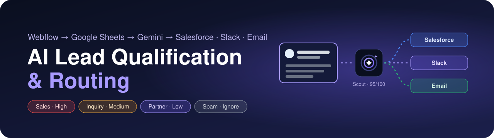
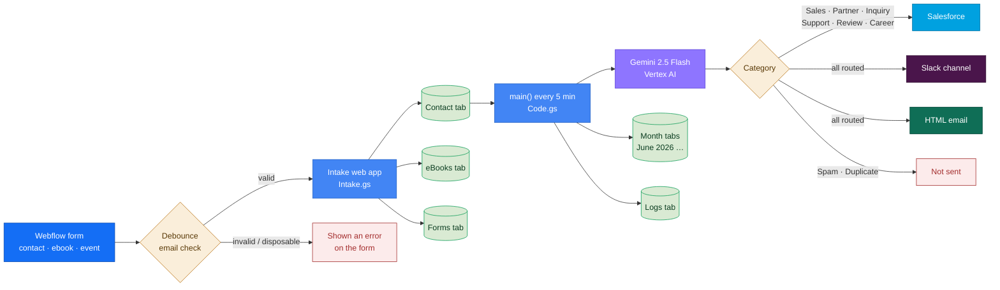
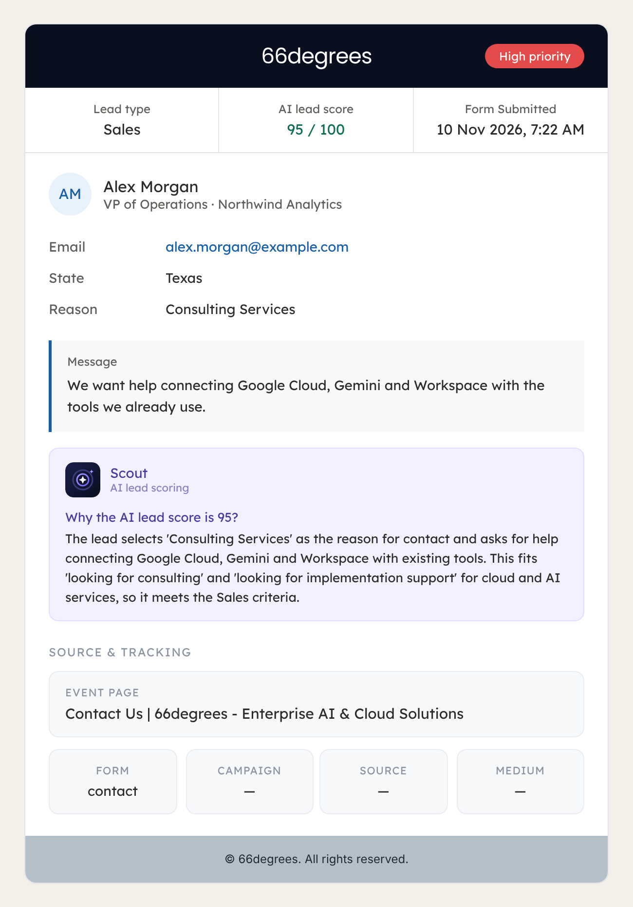
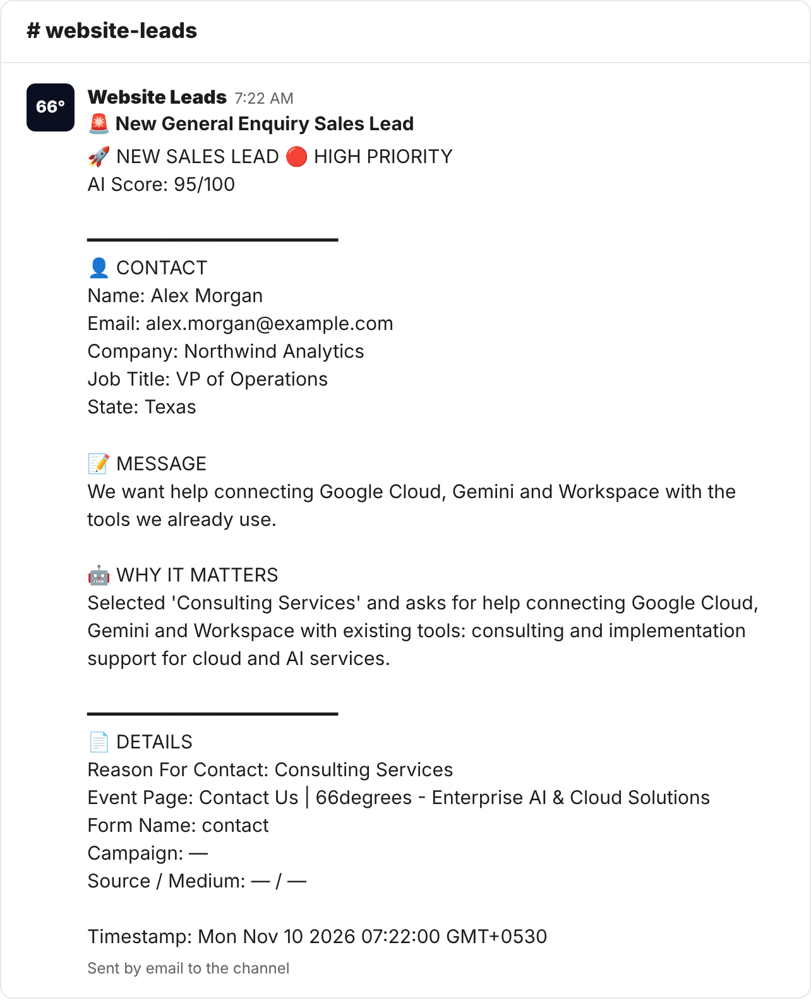

<p align="center">
  
</p>

<p align="center">
  <a href="https://github.com/nexoradev-stack/AI-Lead-Qualification-and-Routing/actions/workflows/ci.yml"></a>
  
  
  
  
  
  
  
  
</p>

Every contact form on the website lands in a Google Sheet. Every few minutes the pipeline removes duplicates and obvious spam, asks **Gemini 2.5 Flash on Vertex AI** what each lead wants, gives it a score from 0 to 100 and a priority, and sends every real lead to **Salesforce**, a **Slack** channel and a designed **HTML email**. Only spam and duplicates are held back. Each lead is also filed into its month's tab, colour coded, and every run is written to a log.

Nobody has to read the inbox to find the five real buyers among fifty submissions.

> [!NOTE]
> Every name, email address, company, ID and URL in this repository is made up. Real values live only in each Apps Script project's **Script properties**, never in code. CI fails if a key, a real ID or a personal email address is committed.

## Contents

- [How it works](#how-it-works)
- [What each lead gets](#what-each-lead-gets)
- [What the team receives](#what-the-team-receives)
- [Repository layout](#repository-layout)
- [Setup](#setup)
- [Email validation (Phase 2)](#email-validation-phase-2)
- [Testing](#testing)
- [Limits to know about](#limits-to-know-about)
- [Credits](#credits)

## How it works



Each run of `main()` does five things, in order, under a script lock so two runs never overlap:

| Step | Function | What it does |
|---|---|---|
| 1 | `importNewLeads` | Copies new rows from the intake **Contact** tab into **Raw Website Leads**, skipping any email + message already there |
| 2 | `checkDuplicates` | Marks repeat submissions as **Duplicate** (score 0, Ignore) |
| 3 | `processOneLeadWithGemini` | Quick rules first (test addresses, keyboard mashing, gibberish), then Gemini classifies the rest |
| 4 | `sendGenuineLeads` | Sends every lead except Spam and Duplicate once to Salesforce, Slack and email, and ticks each one off in the sheet |
| 5 | `moveLeadToMonthTab` | Copies leads from June 2026 on into tabs such as **July 2026**, green for Sales/Partner, yellow for the rest |

Then `writeLog` adds a row to **Logs** with the number of routed leads, the number of spam and duplicates, and whether the run succeeded.

The full design, with the sheet columns and every decision, is in **[ARCHITECTURE.md](ARCHITECTURE.md)**.

## What each lead gets

| Category | Score | Priority | Salesforce | Slack | Email |
|---|---|---|:---:|:---:|:---:|
| 🟥 **Sales** | 80–100 | High | ✅ | ✅ | ✅ |
| 🟪 **Partner** | 40–59 | Low | ✅ | ✅ | ✅ |
| 🟨 **Genuine Inquiry** | 60–79 | Medium | ✅ | ✅ | ✅ |
| 🟨 **Support** | 40–59 | Medium | ✅ | ✅ | ✅ |
| ⬜ **Review Required** | 1–39 | Low | ✅ | ✅ | ✅ |
| 🟦 **Career** | 0 | Ignore | ✅ | ✅ | ✅ |
| ❌ **Spam / Duplicate** | ❌ | ❌ | ❌ | ❌ | ❌ |

> Webflow and Debounce stop spam and duplicate submissions before they reach the sheet. Every other category is sent to Salesforce, Slack and email, and anyone can receive the emails: the recipients are set in Script properties.

Gemini returns the category, score and a one-line reason. The priority is then fixed by the script from the category, so the same kind of lead always gets the same priority.

| Email goes to | Script property |
|---|---|
| Sales | `SALES_EMAIL_RECIPIENTS` |
| Partner | `PARTNER_EMAIL_RECIPIENTS` |
| Genuine Inquiry, Support, Review Required, Career | `OTHER_EMAIL_RECIPIENTS` (uses the partner list if not set) |

Each list can hold any number of addresses, separated by commas.

## What the team receives

Both samples below are made-up leads rendered from the real code.

<table>
  <tr>
    <th width="50%">Email</th>
    <th width="50%">Slack</th>
  </tr>
  <tr>
    <td valign="top"></td>
    <td valign="top"></td>
  </tr>
</table>


**Scout** is the name on the AI scoring card in the email. It shows Gemini's reason for the score, so whoever picks up the lead knows why it was flagged before opening Salesforce. The logo is embedded in the email as an inline image, so nothing needs hosting.

<br clear="left">

## Repository layout

```text
apps-script/
  intake/       Intake.gs         Web app: Webflow form posts → eBooks / Contact / Forms tabs
                appsscript.json
  pipeline/     Code.gs           main(): import, dedupe, Gemini, routing, month tabs, log
                Setup.gs          checkSetup(), installMainTrigger(), removeMainTrigger()
                appsscript.json
webflow/        lead-form.js      Site custom code: hidden fields, UTM, Debounce check, post to intake
tests/          node:test suites run against the real .gs files with fake Google services
scripts/        check-secrets.sh  Fails CI on keys, real IDs or personal email addresses
docs/assets/    banner, Scout logo, sample email and Slack images
```

## Setup

There are two Apps Script projects. Copy each folder's files into its own project (or push them with [clasp](https://github.com/google/clasp)).

### 1. Intake web app

1. Create a spreadsheet with three tabs: **Contact**, **eBooks** and **Forms**.
2. Create an Apps Script project, add `Intake.gs` and `appsscript.json`.
3. In **Project Settings → Script properties**, add `INTAKE_SPREADSHEET_ID`.
4. **Deploy → New deployment → Web app**, execute as *Me*, access *Anyone*. Copy the `/exec` URL.

### 2. Lead pipeline

1. In the leads spreadsheet create **Raw Website Leads** (24 columns, see [ARCHITECTURE.md](ARCHITECTURE.md#sheet-columns)) and **Logs**.
2. Open **Extensions → Apps Script**, add `Code.gs`, `Setup.gs` and `appsscript.json`.
3. Add the Script properties:

| Property | Example (made up) | Required |
|---|---|:---:|
| `SOURCE_SPREADSHEET_ID` | ID of the intake spreadsheet | ✅ |
| `SOURCE_TAB_NAME` | `Contact` | ✅ |
| `RAW_TAB_NAME` | `Raw Website Leads` | ✅ |
| `LAST_IMPORTED_ROW` | `1` | ✅ |
| `VERTEX_PROJECT_ID` | `your-gcp-project` | ✅ |
| `SALESFORCE_FORM_HANDLER_URL` | `https://go.example.com/l/EXAMPLE/handler` | ✅ |
| `SLACK_EMAIL_ADDRESS` | `website-leads-xxxx@yourteam.example` | ✅ |
| `SALES_EMAIL_RECIPIENTS` | `sales@example.com, marketing@example.com` | ✅ |
| `PARTNER_EMAIL_RECIPIENTS` | `marketing@example.com` | ✅ |
| `OTHER_EMAIL_RECIPIENTS` | `support@example.com, hr@example.com` (Inquiry, Support, Review, Career; default: the partner list) | |
| `VERTEX_LOCATION` | `us-central1` (default) | |
| `GEMINI_MODEL` | `gemini-2.5-flash` (default) | |
| `MAIL_FROM` | `marketing@example.com` (must be a Gmail alias of the account) | |
| `MAIL_FROM_NAME` | `66degrees Marketing` (default) | |
| `TRIGGER_MINUTES` | `5` (default; 1, 5, 10, 15 or 30) | |

4. In Google Cloud, enable the **Vertex AI API** on that project and give the account that runs the script the **Vertex AI User** role. Link the Apps Script project to the same Cloud project (**Project Settings → Google Cloud Platform project**).
5. Run `checkSetup()` and fix anything it lists. Then run `installMainTrigger()` once and approve the permissions. `main()` now runs every 5 minutes.

### 3. Webflow

Paste `webflow/lead-form.js` between `<script>` tags in **Site settings → Custom code → Footer code**. Replace `REPLACE_WITH_INTAKE_WEB_APP_URL` with the `/exec` URL and, for Phase 2, `REPLACE_WITH_DEBOUNCE_PUBLIC_KEY` with a Debounce public key. Publish the site.

Form fields must use these names: `first_name`, `last_name`, `email`, `company`, `job_title`, `state`, `reason_for_contact`, `message`. The script adds `event_page`, `formName` and the three UTM fields itself.

## Email validation (Phase 2)

Before a form is submitted, `lead-form.js` checks the address with the [Debounce](https://debounce.io) real-time API.

| Debounce result | Code | What the visitor sees |
|---|:---:|---|
| Syntax error | 1 | “Please enter a valid email address.” |
| Spam trap / invalid | 2 · 6 | “This email address can’t receive mail.” |
| Disposable | 3 | “Please use your work email, not a temporary address.” |
| Accept-all (catch-all) | 4 | Allowed, or blocked if `BLOCK_CATCH_ALL` is on |
| Free provider (Gmail, Yahoo …) | flag | Allowed, or blocked if `BLOCK_FREE_PROVIDERS` is on |
| Deliverable · role · unknown | 5 · 8 · 7 | Allowed |

If Debounce doesn't answer within 4 seconds, the form goes through anyway, so an outage never costs a lead. Use a **public key restricted to your domain**; never put a private API key in site code.

## Testing

```bash
npm test                    # 26 tests, no Google account needed
bash scripts/check-secrets.sh
```

The tests load the real `.gs` files into a Node sandbox with small fakes of `SpreadsheetApp`, `MailApp`, `UrlFetchApp` and the rest. They cover intake routing, de-duplication, the spam rules, the category → priority mapping, routing for every category, the email recipients per category, the run log, sending each lead only once, HTML escaping in the email, the inline logo, month tabs and the Debounce rules. CI runs them on Node 20 and 22, plus the secrets check.

## Limits to know about

- The intake web app URL is public by design (Webflow posts to it). Keep the `/exec` URL out of anything shared outside the site.
- If one Gemini call fails, the run stops and logs ❌; that lead and any after it are picked up on the next run.
- Gemini is called once per lead. A very large burst of submissions may need a longer trigger interval to stay inside Vertex AI quotas.
- Every step reads the whole sheet, so a full year of leads makes a run a little slower.
- Leads from January to May 2026 are never copied to a month tab, by design.

## Credits

| | Contributor | Role |
|---|---|---|
|  | [**nexoradev-stack**](https://github.com/nexoradev-stack) | Owner: system design, Apps Script pipeline, Webflow integration, Salesforce and Slack routing |
|  | [**Claude**](https://www.anthropic.com/claude) (Anthropic) | Repository build-out: masking, Scout identity, Phase 2 form code, tests, CI, documentation |
|  | [**Cursor**](https://cursor.com) | AI pair programming during development |

## Licence

No licence. Copyright © nexoradev-stack. All rights reserved. The code is public to read; it may not be copied, modified or redistributed without permission.
